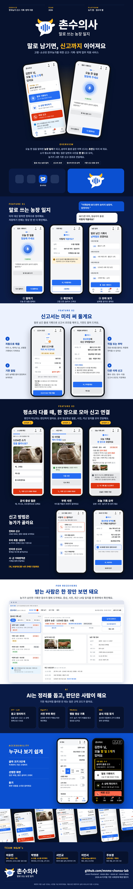

  

 

## 🙂 프로젝트 소개

**촌수의사**는 고령·소규모 한우농가를 위한 신고·기록·방역 업무 지원 서비스입니다.

농가가 오늘 한 일을 말하면 농장 일지가 되고, 송아지 출생 같은 이력 신고는 일지로 신고서 초안을 미리 채워 기한까지 알려 줍니다.
소가 평소와 다를 때는 공식 임상증상 질문·부위 사진·최근 일지를 한 장으로 모아, 농가가 승인하면 원래 쓰던 신고 경로(전화·인터넷 신고서·축협)로 함께 전달합니다.
접수자(축협·방역기관)는 그 한 장 요약을 먼저 보고 농가에 연락합니다.

 

## 📱 주요 기능

- **말로 쓰는 농장 일지** — 말이나 글로 남기면 사육현황·접종·소독·관찰·출입·출생 등 항목으로 정리하고, 저장 전에 "이렇게 적을까요?"로 확인
- **신고서 초안 + 기한 알림** — 출생·폐사·양도·양수·이동 신고서를 일지로 채우고 남은 기한(영업일 기준)을 알림, 직접 제출하거나 축협에 부탁
- **평소와 다를 때 한 장 요약** — 공식 증상 질문 → 부위 사진(부위 일치·화질 확인) → 행동 영상(선택) → 오늘 기록 요약
- **기존 신고 경로로 연결** — 전화 1588-9060 · 인터넷 신고서 · 축협 수신함 중 고르면 기록이 함께 전달 (농가가 승인한 뒤에만)
- **접수자 한 장 요약** — 증상·사진·최근 14일 일지·연락처를 한 화면에, 신고서 6개 항목 옮기기, 관할 농가 연락 우선순위
- **누구나 보기 쉽게** — 글자 크기 5단계, 선명한 화면(고대비), 화면 내용 소리로 듣기, 모든 화면에 [바로 신고]

 

## 🛠 기술 스택

### 💻 Front-End

  
  
  
  

### 🧰 Back-End

  
  
  
  
  
  
  

### 🤖 AI · Data

  
  
  
  
  
  
  

### ☁️ Infra · MLOps

  
  
  
  
  
  

### 🗣️ Collaboration

  
  

 

## 📦 Repositories

| 레포 | 내용 |
| --- | --- |
| [mnm-frontend](https://github.com/mnms-chonsu-lab/mnm-frontend) | 농가 앱 · 접수자 웹 · 어드민 (React · TypeScript · Vite) |
| [mnm-dev](https://github.com/mnms-chonsu-lab/mnm-dev) | 백엔드 API (Spring Boot) · 스테이징 배포 · API 명세 |
| [mnm-ai](https://github.com/mnms-chonsu-lab/mnm-ai) | 에이전트 3개 · 규칙 코드 · 인식 모델 추론 · MLOps |
| [mnm-data](https://github.com/mnms-chonsu-lab/mnm-data) | DB 마이그레이션 · 공공데이터 수집 · SOP·법령 지식베이스 · 시연 시드 |

 

## 🧑‍🤝‍🧑 Team M&M's

<table>
  <tr>
    <td align="center" width="20%"><a href="https://github.com/kkamret"> <b>이유민</b></a> PM · 서비스 기획</td>
    <td align="center" width="20%"><a href="https://github.com/parkmyeonghun"> <b>박명훈</b></a> AI 모델 · 시스템 아키텍처</td>
    <td align="center" width="20%"><a href="https://github.com/tjdlsry"> <b>서인교</b></a> 데이터 파이프라인</td>
    <td align="center" width="20%"><a href="https://github.com/dooooing"> <b>이인서</b></a> 서빙 · MLOps · 클라우드</td>
    <td align="center" width="20%"><a href="https://github.com/joobogyeong"> <b>주보경</b></a> 프론트엔드 · 백엔드</td>
  </tr>
</table>

 

화면의 이름·번호·농장 정보는 모두 가상 데이터예요.
